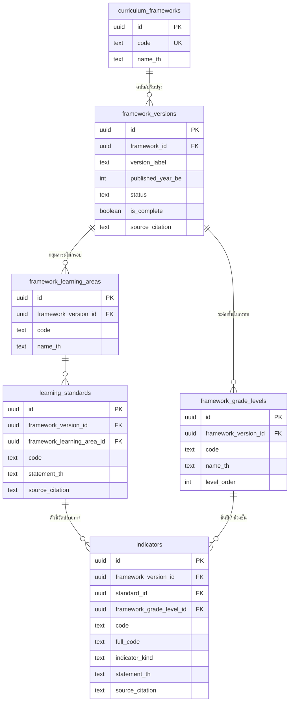
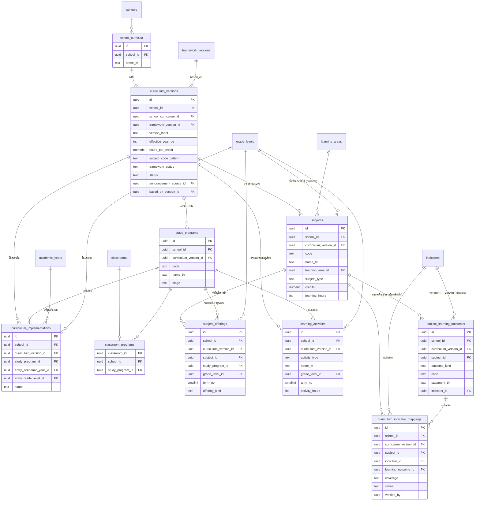
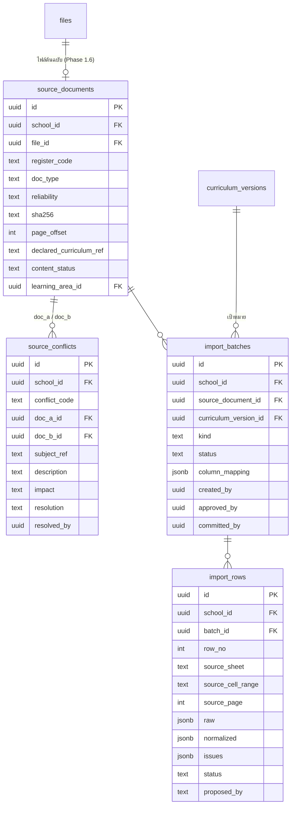
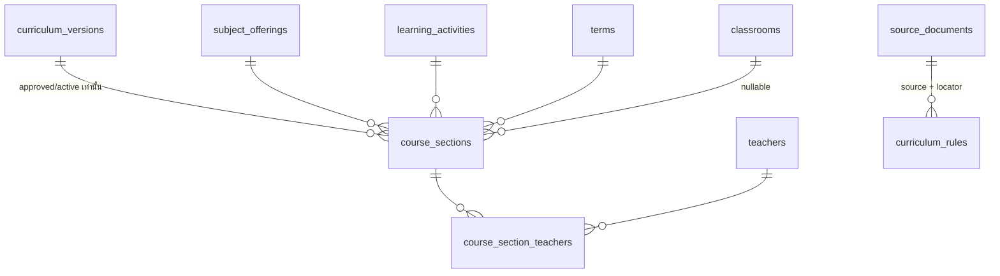

# Curriculum ERD (C1.0)

> สถานะ: **ตรงกับ migration** `20261118000100`–`20261118000400` (C1.1–C1.2) · ไม่มีข้อมูลหลักสูตรจริงในระบบ · รายละเอียดคอลัมน์และ constraint อยู่ใน [Data Dictionary](CURRICULUM-DATA-DICTIONARY.md)
> สัญลักษณ์: ตาราง **ตัวหนา** = ตารางเดิมที่มีอยู่แล้ว (ไม่สร้างซ้ำ) · ตาราง global ไม่มี `school_id`

## 1. National Framework (global · อ่านอย่างเดียว)

## 2. School Curriculum (school_id + RLS)

## 3. Evidence & Import

**Provenance**: ตารางข้อมูลหลัก (`curriculum_versions`, `study_programs`, `subjects`, `subject_offerings`, `learning_activities`, `subject_learning_outcomes`, `curriculum_indicator_mappings`) ทุกตารางมีคอลัมน์ `source_document_id` + `source_locator` + `import_row_id` (ไม่แสดงในแผนภาพเพื่อความอ่านง่าย)

## 4. ความสัมพันธ์ข้ามชั้นกับตารางเดิม

| ตารางใหม่ | อ้างอิงตารางเดิม (composite FK กับ school_id) |
|---|---|
| `subjects.learning_area_id` | **learning_areas** (ไม่สร้างกลุ่มสาระใหม่) |
| `subjects.grade_level_id`, `subject_offerings.grade_level_id`, `learning_activities.grade_level_id`, `curriculum_implementations.entry_grade_level_id` | **grade_levels** |
| `curriculum_implementations.entry_academic_year_id` | **academic_years** |
| `classroom_programs.classroom_id` | **classrooms** |
| `source_documents.file_id` | **files** (private storage + sha256 เดิม) |
| National ↔ School | `learning_areas.national_area_code` ↔ `framework_learning_areas.code`, `grade_levels.national_grade_code` ↔ `framework_grade_levels.code` (คอลัมน์ใหม่ใน C1.1) |

ภายหลัง (C2): `course_sections(subject_offering_id, term_id, classroom_id, teacher_id)` เชื่อมกับ `teachers` / `terms` / `classrooms` ที่มีอยู่

## 5. Views (security_invoker — ใช้ RLS ของผู้เรียก)

| View | ใช้ทำอะไร |
|---|---|
| `v_classroom_curriculum` | ห้องเรียน → ฉบับหลักสูตรของรุ่น (`resolved` / `unresolved` / `ambiguous`) ผ่าน RPC `curriculum_resolve` — ไม่ใช้ปีปัจจุบัน |
| `v_indicator_coverage` | ตัวชี้วัดแต่ละตัว × ฉบับหลักสูตร: `verified` / `pending_review` / `unmapped` + `evidence_incomplete` + `possible_duplicate` + `framework_complete` |

## 6. ส่วนขยาย C1.5–C3 (migrations `20261118000500`–`20261118000900`)

| ตาราง / ฟังก์ชัน | หน้าที่ |
|---|---|
| `subjects.subject_category` (`regular`/`is`) + `education_stage` | รายวิชา IS ไม่สังกัดกลุ่มสาระ แยก ม.ต้น/ม.ปลาย · unique: regular = (version, code) · is = (version, code, stage) |
| `source_conflicts` + category / value_a / value_b / difference / impact_note / recommendation / decision_authority | ทะเบียนข้อขัดแย้ง · สถานะ open → needs_decision → resolved (หัวหน้าฝ่ายวิชาการเท่านั้น) |
| `curriculum_review_queue()` / `curriculum_staged_structure()` | ตรวจความสัมพันธ์ข้ามชุดนำเข้า และยอดจากข้อมูลรอตรวจ (อ่านอย่างเดียว) |
| `curriculum_rules` + `curriculum_compliance_check()` + `curriculum_structure_summary()` | เกณฑ์จากเอกสาร (มีแหล่ง/เวอร์ชัน, ยืนยันโดยมนุษย์) · ผล pass/warning/fail/insufficient_data จากข้อมูลที่บันทึกแล้ว |
| `course_sections` → `course_section_teachers` → `teachers` · `v_teacher_load` | กลุ่มเรียนของหลักสูตรฉบับที่อนุมัติ · ครูหลายคน · แยกคาบ/ชั่วโมงสอน/ชั่วโมงกิจกรรม/หน่วยกิต |

