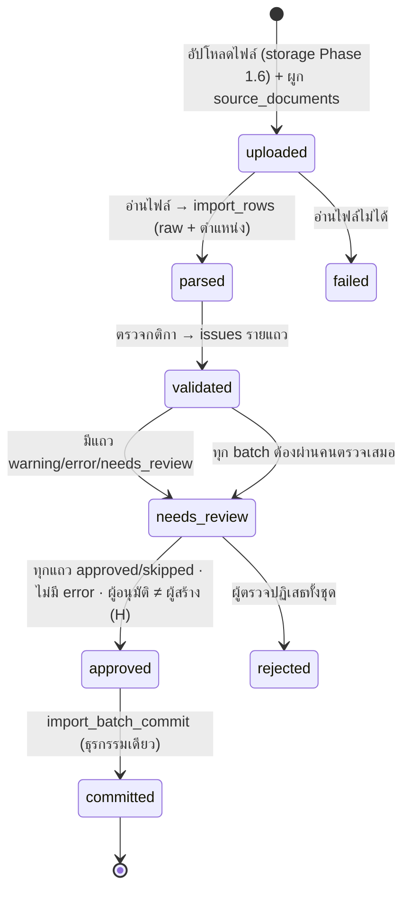

# Curriculum Import Plan (C1.0)

> สถานะ: ออกแบบ รออนุมัติ · ยังไม่นำเข้าข้อมูลจริง · ตาราง/สถานะตรงกับ [Data Dictionary](CURRICULUM-DATA-DICTIONARY.md) §3
> หลักการ: **ไม่มีข้อมูลใดเข้าตารางหลักโดยไม่ผ่าน staging + การตรวจของคน + การยืนยันของผู้รับผิดชอบ**

## 1. ขั้นตอน

| ขั้น | ผู้ทำ | ผลลัพธ์ | เขียนตารางหลัก? |
|---|---|---|---|
| 1. Upload | H S L | ไฟล์ใน storage private + `source_documents` (sha256, reliability) | ไม่ |
| 2. Parse | Edge Function / ผู้ใช้กรอกมือ / AI (เสนอ) | `import_rows.raw` + `source_sheet` / `source_cell_range` / `source_page` | ไม่ |
| 3. Validate | ระบบ | `normalized` + `issues[]` + สถานะแถว | ไม่ |
| 4. Preview & Review | H S L (ขอบเขต) | ตรวจรายแถว แก้ `normalized` ได้ (audit), ตัดสิน approved/skipped | ไม่ |
| 5. Approve | H (≠ ผู้สร้าง) | `import_batches.status = approved` | ไม่ |
| 6. Commit | H ผ่าน RPC | ข้อมูลหลัก + provenance + `import_rows.target_id` | **ใช่ — ขั้นเดียวที่เขียน** |

## 2. กติกาตรวจ (Validation Rules)

ระดับ: **E** = error (commit ไม่ได้) · **W** = warning (ต้องมีผู้ตรวจยืนยัน) · **I** = info

| รหัส | ใช้กับ kind | ตรวจ | ระดับ |
|---|---|---|---|
| V01 | ทุก kind | มี `source_document_id` และ locator ตามรูปแบบ Data Dictionary §0 (PDF ต้องมี `pdf:`) | E |
| V02 | ทุก kind | `curriculum_version` เป้าหมายเป็น `draft` | E |
| V10 | subjects | รหัสวิชาไม่ว่าง และไม่ซ้ำภายใน batch | E |
| V11 | subjects | รหัสวิชาซ้ำกับที่มีอยู่ใน version เดียวกัน (→ ต้องเลือก: ข้าม / อัปเดตใน draft) | W |
| V12 | subjects | รูปแบบรหัสตามแนวปฏิบัติที่ยืนยันจาก SRC-01/SRC-04 (กฎเก็บเป็น regex ต่อ curriculum_version ไม่ hard-code) | W |
| V13 | subjects | กลุ่มสาระ map ได้กับ `learning_areas` ของโรงเรียน (ห้ามสร้างกลุ่มสาระใหม่จาก import) | E |
| V14 | subjects | `subject_type` ∈ {basic, additional} | E |
| V15 | study_programs | รหัสแผนไม่ว่าง ไม่ซ้ำใน version · `stage` ตรงกับ `grade_levels.stage` ที่มีอยู่ | E |
| V16 | study_programs | ชื่อแผนตรงตามเอกสาร (ห้ามตั้งชื่อเอง) | W |
| V20 | subjects | หน่วยกิตเป็นตัวเลข ≥ 0 และทศนิยมไม่เกิน 1 ตำแหน่ง | E |
| V21 | subjects | ชั่วโมงเรียนเป็นจำนวนเต็ม ≥ 0 | E |
| V22 | subjects | ถ้า version มี `hours_per_credit`: แจ้งเมื่อ `learning_hours ≠ credits × hours_per_credit` — **ข้อมูลเท่านั้น** ไม่แก้ค่า ไม่บล็อก (CF-07: 1.0 หน่วยกิต = 20 ชม. มีจริง) | I |
| V30 | offerings / activities | ระดับชั้น map ได้กับ `grade_levels` ของโรงเรียน | E |
| V31 | offerings / activities | ภาคเรียน ∈ {1, 2, ว่าง = ทั้งปี} | E |
| V32 | offerings | ช่วงชั้นของแผนการเรียน = ช่วงชั้นของระดับชั้น | E |
| V33 | offerings | รายวิชาเดียวซ้ำในชั้น/ภาค/แผนเดียวกัน | E |
| V34 | offerings | ผลรวมหน่วยกิต/ชั่วโมงต่อชั้นต่อภาค เทียบกับยอดรวมในเอกสาร (ถ้ามีแถวรวมในต้นฉบับ) | W |
| V40 | activities | ชั่วโมงกิจกรรม ≥ 0 และไม่มีหน่วยกิต (ถ้าต้นฉบับมีหน่วยกิตในกิจกรรม → แจ้ง) | W |
| V45 | learning_outcomes | รายวิชาอ้างถึงมีอยู่ใน version เดียวกัน และเป็น `additional` · รหัสไม่ซ้ำต่อรายวิชา | E |
| V50 | mappings | ตัวชี้วัดอยู่ใน framework_version ของ curriculum_version และกลุ่มสาระตรงกัน | E |
| V51 | mappings | ตัวชี้วัดชั้นปีตรงกับชั้นของรายวิชา | W |
| V60 | ทุก kind | ค่าขัดกับแหล่งที่น่าเชื่อถือกว่า (A/B) → สร้าง `source_conflicts` อัตโนมัติ | W |
| V61 | ทุก kind | แถว `proposed_by = ai` | สถานะเริ่ม `needs_review` เสมอ |
| V62 | ทุก kind (Excel) | หัวชีตระบุฉบับหลักสูตรไม่ตรงกับ version เป้าหมาย (CF-05: ชีตระบุ 2561) → ทุกแถวของชีต `needs_review` | W |
| V63 | ทุก kind (Excel) | ค่าต่างกันระหว่าง SRC-05 กับ SRC-06 ในตำแหน่งเดียวกัน (CF-06: 34 เซลล์) → `source_conflicts` รายเซลล์ | W |
| V64 | ทุก kind | `source_documents.content_status` = `empty` หรือ `duplicate` → สร้าง batch ไม่ได้ | E |
| V65 | ทุก kind | ข้อมูลเกี่ยวข้องกับ conflict สถานะ `open` และ impact `blocking` → commit ไม่ได้ | E |

**ไม่มีการเดาค่า**: เซลล์ที่อ่านไม่ได้/ว่าง → แถว `error` หรือ `needs_review` พร้อมข้อความ ไม่เติมค่าเอง

## 3. Excel (SRC-05, SRC-06)

1. เก็บไฟล์ต้นฉบับใน storage private (Phase 1.6 — sha256) แล้วสร้าง `source_documents` ระดับ **C**
2. ผู้ใช้เลือก **mapping ต่อ Sheet**: ช่วงหัวตาราง, คอลัมน์ → ฟิลด์ (รหัส / ชื่อ / หน่วยกิต / ชั่วโมง / ชั้น / ภาค / แผนการเรียน) — บันทึก mapping ใน `import_batches` เพื่อทำซ้ำได้
3. ทุกแถว: `source_sheet` + `source_cell_range` (เช่น `ม.4 วิทย์!B12:G12`) และ `raw` = ค่าตามเซลล์จริง (รวมเซลล์ผสาน/สูตร: เก็บค่าที่คำนวณแล้ว + ระบุว่าเป็นสูตร)
4. แถวสรุป/รวมยอด → ไม่สร้างข้อมูล แต่ใช้ตรวจ V34
5. **ไฟล์สองชุดไม่ทับกัน**: SRC-05 และ SRC-06 นำเข้าเป็นคนละ batch · ชีตระบุหลักสูตร 2561 (CF-05) และต่างกัน 34 เซลล์ (CF-06) จึง **ห้ามสมมติ** ว่าเป็นโครงสร้างฉบับ 2569 — ใช้หลังสกัด SRC-01 แล้ว เพื่อตรวจความแตกต่างเท่านั้น จนกว่าจะยืนยัน H1/H2

## 4. PDF (SRC-01 – SRC-04) — เริ่มที่ SRC-01 ก่อน (คำสั่งผู้ใช้)

1. สกัดข้อความทีละหน้า → เสนอแถว (`proposed_by = parser`) พร้อม `source_page` (= หน้า PDF) และ locator `pdf:N;book:M`
2. ข้อความไทยใน PDF อาจสระ/วรรณยุกต์เพี้ยน → ทุกแถวจาก PDF เริ่มที่ `needs_review` และหน้าตรวจแสดงภาพหน้าต้นฉบับคู่กัน
3. กรอกมือได้ (`proposed_by = manual`) แต่ต้องอ้างหน้าเสมอ (V01)
4. ประกาศใช้หลักสูตร (การเริ่มใช้กับ ม.1 และ ม.4) บันทึกเป็น `curriculum_versions.announcement_source_id` + `announcement_locator` และ `curriculum_implementations.decided_source_id` — ไม่นำเข้าเป็นแถวข้อมูลทั่วไป

## 5. AI (ถ้าใช้ในอนาคต)

| อนุญาต | ไม่อนุญาต |
|---|---|
| อ่านไฟล์ที่ผู้ใช้อัปโหลดแล้วเสนอ `import_rows` (`proposed_by = ai`, สถานะ `needs_review`) | ตัดสินแถว (approve/skip), อนุมัติ batch, commit |
| ชี้จุดที่น่าจะขัดแย้ง (สร้าง `source_conflicts` สถานะ `open`) | แก้ตารางหลัก / ปิด conflict / อนุมัติ version |
| อธิบายเหตุผลของ issue | ใช้ service_role กับ RPC อนุมัติ (RPC ปฏิเสธเมื่อ `auth.uid()` ว่างหรือเป็นบัญชีระบบ) |

## 6. หน้าจอตรวจ (Dark Premium V2 — C1.3)

- รายการ batch + สถานะ + ตัวนับ valid / warning / error
- ตารางแถว: ค่าเดิม (raw) | ค่าแปลงแล้ว (normalized) | issues | ตำแหน่งต้นฉบับ (คลิกเปิด Sheet/หน้า) | ปุ่ม อนุมัติ / ข้าม / แก้ไข
- กรอง: เฉพาะ error / warning / กลุ่มสาระ (L เห็นเฉพาะของตน)
- ปุ่ม commit เปิดได้เฉพาะ H เมื่อเงื่อนไขครบ พร้อมสรุปจำนวนที่จะเขียน

## 7. การทดสอบที่ต้องมีใน C1.2–C1.3

pgTAP: แถว error commit ไม่ได้ · ผู้สร้างอนุมัติ batch ตนเองไม่ได้ · L ตัดสินแถวนอกกลุ่มสาระไม่ได้ · service_role / AI อนุมัติไม่ได้ · commit แล้วข้อมูลหลักมี provenance ครบ · version `approved` แก้ไม่ได้ · ข้ามโรงเรียนไม่ได้
E2E: อัปโหลด Excel ตัวอย่าง **ที่สร้างขึ้นเพื่อทดสอบ (ไม่ใช่ข้อมูลจริง)** → preview → แก้ → อนุมัติ → commit
