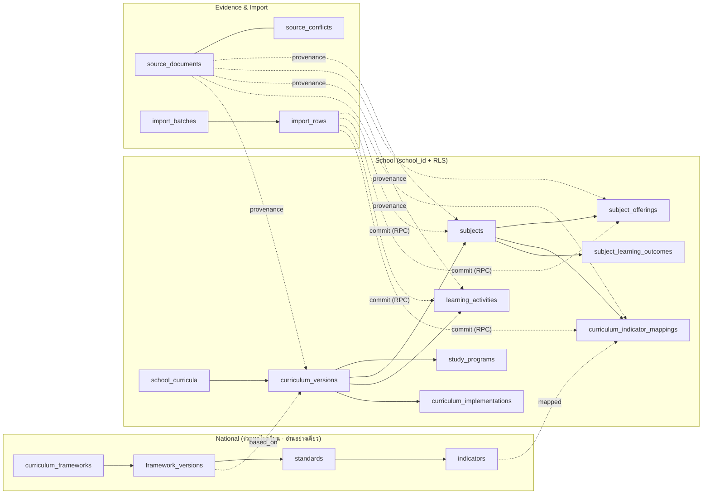

# Curriculum Intelligence — Architecture (C1.0)

> สถานะ: **ออกแบบ รออนุมัติ C1.1** · ยังไม่มี migration / ตารางจริง / ข้อมูลจริง
> เอกสารชุดนี้: [Source Register](CURRICULUM-SOURCE-REGISTER.md) · [Source Audit Results](CURRICULUM-SOURCE-AUDIT-RESULTS.md) · [ERD](CURRICULUM-ERD.md) · [Data Dictionary](CURRICULUM-DATA-DICTIONARY.md) · [Import Plan](CURRICULUM-IMPORT-PLAN.md)
> ข้อมูลหลักสูตรทุกค่าในระบบต้องมาจากเอกสารใน Source Register — เอกสารนี้ไม่มีข้อมูลหลักสูตรจริงใด ๆ

## 1. Repository Audit (branch `claude/stoic-feynman-y7af1p` @ `2cce8a4`)

Migration ปัจจุบัน 11 ไฟล์ (20261112000100 → 20261117000100) — **ไม่มี** ตาราง curricula / subjects / standards / indicators / curriculum_structure (ตรวจด้วย grep `create table` ทั้งโฟลเดอร์)

| ตารางเดิม | ใช้ในระบบหลักสูตรอย่างไร | ต้องเพิ่มใน C1.1 |
|---|---|---|
| `schools` | tenant ของข้อมูลหลักสูตรโรงเรียน | – |
| `learning_areas` | กลุ่มสาระของโรงเรียน — **ใช้ตารางเดิม ไม่สร้างใหม่** | คอลัมน์ `national_area_code` (map กับกลุ่มสาระในกรอบแกนกลาง) |
| `grade_levels` | ระดับชั้น ม.1–ม.6 (มี `stage`, `level_order`) | คอลัมน์ `national_grade_code` (map กับระดับชั้นของตัวชี้วัด) |
| `academic_years`, `terms` | ปีที่เริ่มใช้หลักสูตร / รุ่นที่เข้าเรียน / ภาคเรียนของรายวิชา | – |
| `classrooms` | ผูกห้องกับแผนการเรียน (ผ่าน `classroom_programs`) | – |
| `teachers` | ผู้รับผิดชอบรายวิชา (C2 — course sections) | – |
| `files`, `documents` (Phase 1.6) | เก็บไฟล์ต้นฉบับ (PDF/ZIP/Excel) แบบ private + sha256 | `documents.kind` เพิ่มค่า `curriculum_source` |
| `audit_logs` | ประวัติการแก้ไขทุกตารางใหม่ (trigger เดิม) | – |
| `user_roles` + `my_learning_area_ids()` | ขอบเขตหัวหน้ากลุ่มสาระ | – |

Phase 0 เคยร่าง `CURRICULA / LEARNING_STANDARDS / INDICATORS / SUBJECTS / CURRICULUM_STRUCTURE / IMPORT_JOBS / IMPORT_ROWS` แบบง่าย — C1.0 ขยายให้รองรับ **หลายฉบับ หลายแผนการเรียน หลายรุ่น** และ **นำเข้าแบบตรวจสอบได้** (ตารางใหม่แทนที่ร่างเดิม ไม่สร้างซ้ำ)

## 2. หลักการ

1. **แยก 3 ชั้น**: กรอบหลักสูตรแกนกลาง (National, ใช้ร่วมทุกโรงเรียน) → หลักสูตรสถานศึกษา (School, มี version) → การนำไปใช้ (Implementation, ต่อรุ่นผู้เรียน)
2. **Version ไม่เขียนทับ**: ฉบับที่อนุมัติแล้ว (`approved`/`active`) แก้ไม่ได้ — แก้โดยสร้าง version ใหม่
3. **หลักสูตรต่างฉบับในปีเดียวกันได้**: ฉบับที่ใช้ขึ้นกับ *รุ่นที่เข้าเรียน* (cohort) ไม่ใช่ปีการศึกษาปัจจุบัน
4. **หน่วยกิต ≠ ชั่วโมงเรียน ≠ ชั่วโมงกิจกรรม**: เก็บแยกคอลัมน์/แยกตาราง ไม่คำนวณแทนกัน — ต้นฉบับมีรายวิชา 1.0 หน่วยกิต 20 ชั่วโมง (CF-07) จึง **ไม่มีกฎชั่วโมงต่อหน่วยกิตแบบบังคับ** และไม่เขียนทับค่าจากต้นฉบับ
5. **ทุกค่ามีที่มา**: แถวข้อมูลหลักอ้าง `source_document_id` + ตำแหน่ง (`pdf:` หน้า PDF / `book:` หน้าเล่ม / Sheet!Cell) — หน้าเล่มกับหน้า PDF ต่างกัน (ประกาศ SRC-01 = เล่มหน้า 3, PDF หน้า 4)
6. **ไม่มีข้อมูลใดเข้าตารางหลักโดยไม่ผ่านคนตรวจ**: นำเข้า → staging → ตรวจ → ผู้รับผิดชอบยืนยัน → commit (RPC)
7. **AI = ผู้เสนอเท่านั้น**: สร้างได้แค่แถว staging สถานะ `needs_review` ไม่มีสิทธิ์อนุมัติ / commit / แก้ตารางหลัก

## 3. ภาพรวมโดเมน



## 4. การเลือกฉบับหลักสูตรตามรุ่น (Cohort Resolution)

รุ่น = (ปีการศึกษาที่เข้าเรียน, ระดับชั้นแรกเข้า, แผนการเรียน) — เช่น เข้า ม.1 ปี X หรือ ม.4 ปี X
หลักฐานที่ยืนยันแล้ว: SRC-01 PDF หน้า 4 (ประกาศ 25 พ.ค. 2569) — หลักสูตร 2569 ใช้กับ ม.1 และ ม.4 ปีการศึกษา 2569 → implementation 2 แถว ส่วนฉบับที่ ม.2-3 / ม.5-6 ใช้ ต้องระบุจากเอกสารเพิ่ม (ไม่สมมติ)
`curriculum_implementations` บันทึกว่ารุ่นใดใช้ `curriculum_version` ใด

สำหรับห้องเรียน/นักเรียนชั้น G ในปีการศึกษา Y:

```
entry_year = Y − (G.level_order − entry_grade.level_order)
version    = curriculum_implementations ที่ (entry_year, entry_grade, study_program หรือ null) ตรงกัน
```

ดังนั้นในปีเดียวกัน ม.1 กับ ม.2 ใช้คนละฉบับได้โดยไม่ต้องมีกรณีพิเศษ — เช่น implementation (entry ม.1/2569) และ (entry ม.4/2569) → ฉบับ 2569; รุ่นที่เข้าก่อนหน้า → ฉบับเดิม (เมื่อระบุได้จากเอกสาร)
View `v_classroom_curriculum` (C1.1) คำนวณฉบับของแต่ละห้องตามกฎนี้ และตรวจว่า **ทุกห้องในปีปัจจุบันมีฉบับเดียวเท่านั้น** (ไม่มีช่องว่าง / ไม่ทับซ้อน)

## 5. ความปลอดภัย (ตาม Permission Matrix PHASE-0 §5 แถว "หลักสูตร มาตรฐาน ตัวชี้วัด รายวิชา")

| บทบาท | National | School curriculum | Import |
|---|---|---|---|
| system_admin | อ่าน | อ่าน | – |
| academic_head | อ่าน | **จัดการ + อนุมัติ version** | สร้าง / ตรวจ / **อนุมัติ commit** |
| academic_staff | อ่าน | จัดการ (ฉบับ `draft`) | สร้าง / ตรวจ / อนุมัติแถว (commit ต้องเป็น academic_head หรือคนละคนกับผู้สร้าง — ดู D3) |
| learning_area_head | อ่าน | จัดการ **เฉพาะกลุ่มสาระตน** ในฉบับ `draft` | ตรวจแถวของกลุ่มสาระตน |
| executive | อ่าน | **อ่านอย่างเดียว** | อ่าน |
| teacher | อ่าน | อ่านฉบับ `approved/active` (ข้อมูลที่ใช้สอน) | – |
| AI / service | – | – | เขียน `import_rows` สถานะ `needs_review` เท่านั้น |

- ทุกตารางโรงเรียนมี `school_id` + composite FK `(…_id, school_id)` แบบเดียวกับ Phase 1.4–1.7 · เปิด RLS + revoke default · ไม่มี DELETE (ใช้สถานะ)
- การเปลี่ยนสถานะ (อนุมัติ version, เปิดใช้, commit import) ผ่าน RPC `security definer` ที่ตรวจ `auth.uid()` เป็นมนุษย์ที่มีบทบาท (ไม่รับ service_role)
- helper ใหม่ (C1.1): `private.can_manage_curriculum(p_learning_area_id)` — null-safe (`coalesce(..., false)`) ตามบทเรียน Phase 1.7

## 6. การตัดสินใจ (สถานะหลังผล Source Audit)

| # | เรื่อง | ผล | สถานะ |
|---|---|---|---|
| D1 | ที่เก็บกรอบแกนกลาง | ตาราง global ไม่มี school_id อ่านได้ทุกคน เขียนได้เฉพาะ migration/seed ที่ผ่านการตรวจ | **APPROVED** |
| D2 | กรอบแกนกลางที่หลักสูตร 2569 อ้างอิง | หลักสูตรแกนกลาง 2551 ฉบับปรับปรุง 2560 (SRC-04; SRC-01 เป็นหลัก) | **PROVISIONAL** — CF-02 (ภาษาอังกฤษระบุปรับปรุง 2569) ยัง open · `curriculum_versions.framework_status = provisional` |
| D3 | ผู้ยืนยัน commit | กติกา 2 คน: ผู้อนุมัติ ≠ ผู้สร้าง batch และต้องเป็น academic_head | **APPROVED** |
| D4 | Excel parser | ฝั่ง server (Edge Function) ไฟล์ไม่ออกจาก storage private | **APPROVED** (ตรวจ license/ขนาดไลบรารีใน C1.2) |
| D5 | PDF | สกัดข้อความ + เลขหน้า → ทุกแถว `needs_review` → คนตรวจ | **APPROVED** |
| D6 | หน่วยกิต / ชั่วโมง | เก็บแยก · `hours_per_credit` **optional** ใช้เตือนเท่านั้น และ **ห้ามเขียนทับค่าจากต้นฉบับ** (CF-07: 1.0 หน่วยกิต = 20 ชม.) | **APPROVED** |

## 7. แผนระยะถัดไป (แต่ละขั้นรออนุมัติ)

| ระยะ | ขอบเขต |
|---|---|
| **C1.1** | สกัดข้อมูลจาก SRC-01 เป็นไฟล์ staging (ไม่เข้า DB) ตามที่ผู้ใช้สั่ง → migration ตาราง + RLS + pgTAP หลังอนุมัติ |
| C1.2 | Import pipeline: อัปโหลด → parse → validate → preview รายแถว (ยังไม่ commit) |
| C1.3 | Review / approve / commit RPC + หน้าจอตรวจ (Dark Premium V2) |
| C1.4 | หน้าจออ่านหลักสูตร: โครงสร้างต่อแผนการเรียน/ชั้น/ภาค, รายวิชา, ตัวชี้วัด |
| C1.5 | Curriculum Mapping + รายงานความครอบคลุมตัวชี้วัด |
