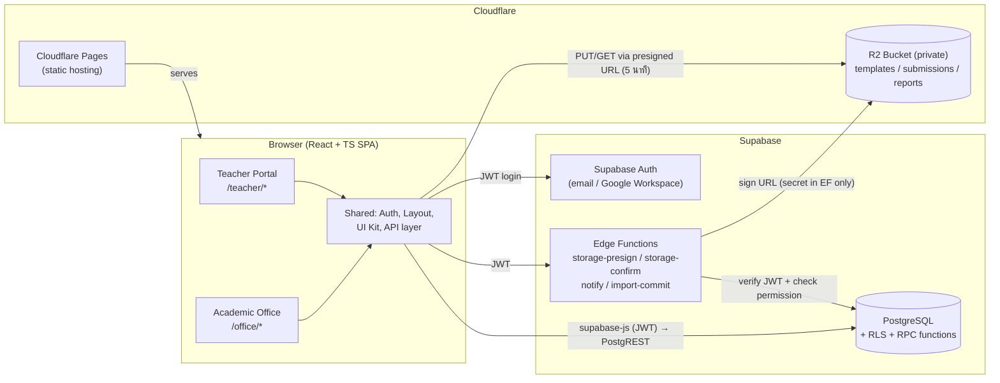
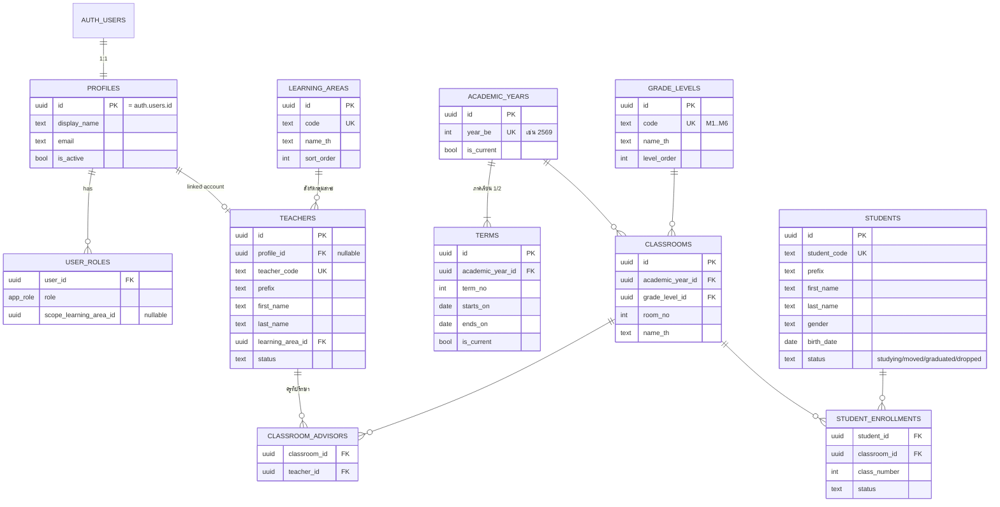
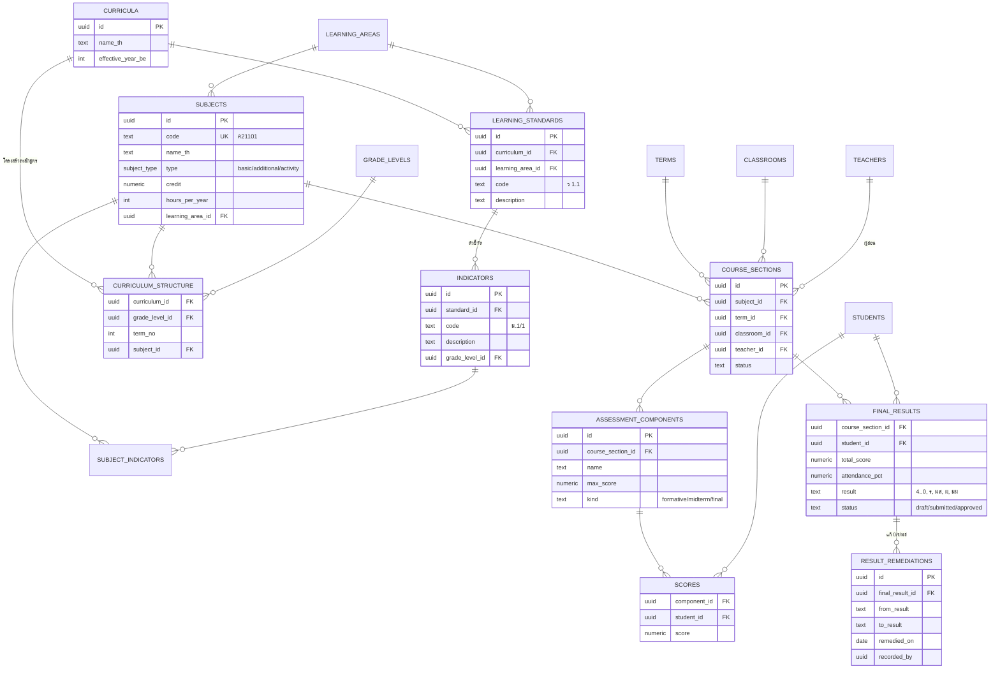
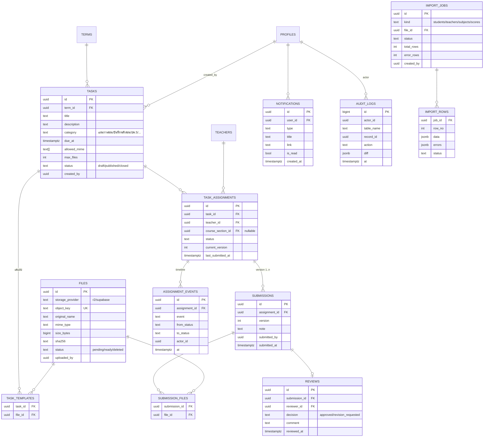
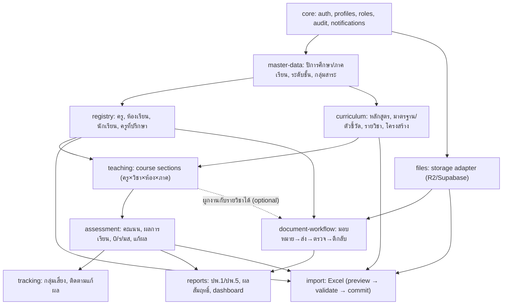
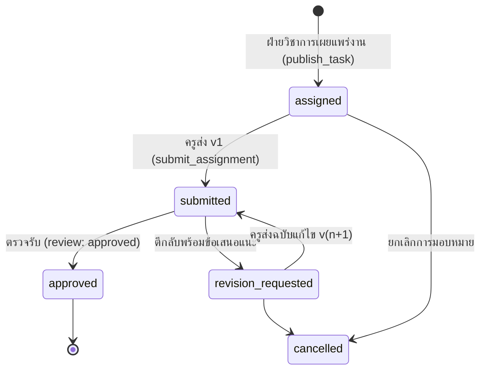
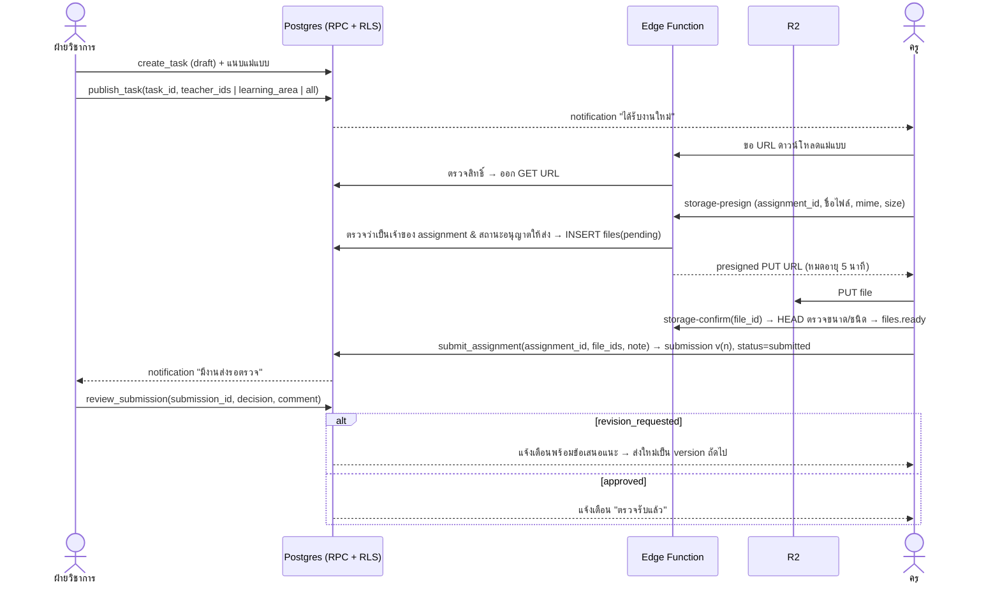

# Sak Ngam Academic Platform — Phase 0: Architecture & Foundation

> สถานะ: ร่างสำหรับพิจารณา (ยังไม่มีการแก้ไขฐานข้อมูล ไม่มีการติดตั้ง Dependencies ไม่มีการ Push)
> วันที่: 2026-11-12

---

## 1. ผลการสำรวจ Repository

| รายการ | ผลการตรวจสอบ |
|---|---|
| Repository | `sakngamacademic-lang/academic-sakngam` |
| Branch ทำงาน | `claude/stoic-feynman-y7af1p` (ยังไม่มี commit) |
| Remote | ไม่มี branch/commit ใด ๆ บน origin → **Repository ว่างเปล่า** |
| โค้ดเดิม / package.json | ไม่มี |
| Supabase | ไม่พบ Environment Variable, ไม่มีโฟลเดอร์ `supabase/`, ไม่มี MCP Connector ของ Supabase ในเซสชันนี้ → **ยังไม่ได้เชื่อมต่อ** |
| Cloudflare R2 | ยังไม่มีการตั้งค่า |

**ข้อสรุป:** ไม่มีโค้ดเดิมให้ใช้ต่อ จึงเริ่มโครงสร้างใหม่ได้ทั้งหมด แต่ควรวางให้เป็น *feature-based* เพื่อให้เพิ่มโมดูลทีละชุดได้โดยไม่กระทบกัน

### Tech Stack ที่เสนอ (เพิ่มตามความจำเป็นในแต่ละงานย่อยเท่านั้น)

| ชั้น | เทคโนโลยี | เหตุผล |
|---|---|---|
| Build | Vite + React 18 + TypeScript (strict) | เร็ว, เป็นมาตรฐาน, deploy เป็น static ได้ (Cloudflare Pages) |
| Routing | React Router v6 (data router) | รองรับ route guard ตามบทบาท, lazy load ต่อโมดูล |
| Server state | TanStack Query | cache/invalidate ข้อมูลจาก Supabase |
| UI | Tailwind CSS + shadcn/ui (Radix) | เป็นโค้ดในโปรเจกต์เอง ปรับแต่งภาษาไทยได้ง่าย |
| Form/Validation | react-hook-form + zod | ใช้ schema เดียวกันตรวจทั้งฟอร์มและไฟล์นำเข้า |
| Backend | Supabase (PostgreSQL + Auth + RLS + Edge Functions) | สิทธิ์บังคับที่ฐานข้อมูล ไม่พึ่ง frontend |
| ไฟล์ | Cloudflare R2 (S3 API) ผ่าน Presigned URL ที่ออกโดย Edge Function | ไม่มี credential ฝั่ง client, ไม่มีค่า egress |
| Excel | SheetJS (`xlsx`) — ติดตั้งเมื่อถึงงานนำเข้า | อ่านไฟล์ฝั่ง browser เพื่อ preview ก่อนบันทึก |
| ทดสอบ | Vitest + Testing Library, pgTAP สำหรับ RLS | ทดสอบสิทธิ์ที่ระดับฐานข้อมูล |

---

## 2. Architecture Diagram



หลักการสำคัญ
1. **ความปลอดภัยอยู่ที่ฐานข้อมูล** — ทุกตารางเปิด RLS, การเปลี่ยนสถานะงาน (ส่ง/ตรวจ/ตีกลับ) ทำผ่าน RPC function เท่านั้น
2. **Frontend ไม่ถือ secret** ใด ๆ นอกจาก `anon key` (ซึ่งเป็น public โดยออกแบบ)
3. **R2 เข้าถึงผ่าน Edge Function** ที่ตรวจสิทธิ์ก่อนออก URL ชั่วคราว
4. **Storage Adapter** — โค้ดฝั่ง client เรียกผ่าน interface เดียว เพื่อสลับระหว่าง Supabase Storage (ช่วงแรก/dev) กับ R2 ได้

---

## 3. Database ERD (เบื้องต้น)

### 3.1 Identity, ปีการศึกษา, ทะเบียน



### 3.2 หลักสูตร รายวิชา และการวัดผล



### 3.3 ภาระงานเอกสาร ไฟล์ และระบบสนับสนุน



**ข้อตกลงร่วมทุกตาราง:** `id uuid default gen_random_uuid()`, `created_at`, `updated_at` (trigger), soft-delete ผ่าน `status`/`archived_at` สำหรับข้อมูลทะเบียน (ไม่ลบจริง), unique constraint ตามธรรมชาติ (เช่น `student_code`, `(classroom_id, class_number)`), ปี พ.ศ. เก็บเป็น `int` แยก ส่วนวันที่เก็บเป็น `date` (ค.ศ.) แล้วแสดงผลเป็น พ.ศ. ที่ UI

---

## 4. รายการโมดูลและความสัมพันธ์



| โมดูล | Academic Office | Teacher Portal | ขึ้นกับ |
|---|---|---|---|
| core | จัดการผู้ใช้/บทบาท, audit log | เข้าสู่ระบบ, โปรไฟล์, แจ้งเตือน | – |
| master-data | ตั้งค่าปี/ภาค/ระดับชั้น/กลุ่มสาระ | (อ่านอย่างเดียว) | core |
| registry | ทะเบียนครู ห้อง นักเรียน | ดูห้องที่ปรึกษา/ห้องที่สอน | master-data |
| curriculum | หลักสูตร มาตรฐาน ตัวชี้วัด รายวิชา | ดูรายวิชาที่สอน | master-data |
| teaching | จัดครูผู้สอน | รายวิชาของฉัน | registry, curriculum |
| assessment | ตรวจ/อนุมัติผลการเรียน | กรอกคะแนน ส่งผล | teaching |
| tracking | ติดตาม 0/ร/มส, กลุ่มเสี่ยง | บันทึกการแก้ผลของนักเรียนตน | assessment |
| import | นำเข้า Excel | – | registry/curriculum/assessment, files |
| document-workflow | สร้างงาน มอบหมาย ตรวจรับ | รับงาน ส่ง แก้ไข ติดตาม | files, registry |
| reports | ปพ., ผลสัมฤทธิ์, dashboard | Dashboard ส่วนตัว | assessment, tasks |

---

## 5. บทบาทผู้ใช้และ Permission Matrix

### บทบาท (enum `app_role`)

| Role | ความหมาย |
|---|---|
| `system_admin` | ผู้ดูแลระบบ (IT) จัดการผู้ใช้/บทบาท/ตั้งค่า — ไม่จำเป็นต้องเห็นคะแนน |
| `academic_head` | หัวหน้าฝ่ายวิชาการ — สิทธิ์เต็มในงานวิชาการ อนุมัติผลการเรียน |
| `academic_staff` | เจ้าหน้าที่วิชาการ / งานทะเบียน / งานวัดผล — จัดการข้อมูล สร้างงาน ตรวจรับ |
| `learning_area_head` | หัวหน้ากลุ่มสาระ — ตรวจรับเอกสาร/ดูผลการเรียน *เฉพาะกลุ่มสาระตน* (scope) |
| `executive` | ผู้บริหาร — ดู Dashboard/รายงานทั้งหมด อ่านอย่างเดียว |
| `teacher` | ครูผู้สอน — เฉพาะข้อมูลที่ตนรับผิดชอบ |

> "ครูที่ปรึกษา" และ "ครูผู้สอนวิชา X" ไม่ใช่ role แต่ **อนุมานจากข้อมูล** (`classroom_advisors`, `course_sections`) แล้วใช้ใน RLS
> ผู้ใช้ 1 คนมีได้หลายบทบาท (เช่น ครู + หัวหน้ากลุ่มสาระ)

### Permission Matrix

สัญลักษณ์: **F** = เต็ม (CRUD), **R** = อ่าน, **O** = เฉพาะของตนเอง, **S** = เฉพาะ scope กลุ่มสาระ, **A** = อนุมัติ, – = ไม่มีสิทธิ์

| ทรัพยากร | system_admin | academic_head | academic_staff | learning_area_head | executive | teacher |
|---|---|---|---|---|---|---|
| ผู้ใช้ & บทบาท | F | R | R | – | – | O (โปรไฟล์) |
| ปีการศึกษา/ภาค/ระดับชั้น | F | F | R | R | R | R |
| ทะเบียนครู | F | F | F | R(S) | R | O |
| ทะเบียนนักเรียน/ห้องเรียน | R | F | F | R(S) | R | R (ห้องที่สอน/ที่ปรึกษา) |
| หลักสูตร มาตรฐาน ตัวชี้วัด รายวิชา | R | F | F | F(S) | R | R |
| จัดครูผู้สอน (course sections) | – | F | F | R(S) | R | O (R) |
| คะแนน/ผลการเรียน (กรอก) | – | R | R | R(S) | R (สรุป) | O (draft) |
| อนุมัติผลการเรียน | – | A | – | R(S) | – | – |
| ติดตาม 0/ร/มส | – | F | F | R(S) | R | O (บันทึกแก้ผล) |
| นำเข้า Excel | – | F | F | – | – | – |
| สร้าง/เผยแพร่ภาระงาน | – | F | F | F(S) | – | – |
| ส่งเอกสาร | – | – | – | O | – | O |
| ตรวจรับ/ตีกลับ | – | A | A | A(S) | – | – |
| ไฟล์แม่แบบ | – | F | F | F(S) | R | R |
| รายงาน ปพ./ผลสัมฤทธิ์ | – | F | F | R(S) | R | O |
| Audit log | R | R | – | – | – | – |

### แนวทางบังคับใช้ใน PostgreSQL
- ตาราง `user_roles(user_id, role, scope_learning_area_id)` + ฟังก์ชัน `SECURITY DEFINER STABLE` เช่น `auth_has_role(role)`, `auth_is_office()`, `auth_teacher_id()`, `auth_teaches_section(section_id)`, `auth_in_learning_area_scope(area_id)` — ใช้ใน policy ทุกตาราง (กำหนด `search_path` ให้ฟังก์ชันเสมอ)
- ระยะต่อไปพิจารณา Custom Access Token Hook ใส่ roles ใน JWT เพื่อลด query (หลังระบบเสถียร)
- การเปลี่ยนสถานะสำคัญทำผ่าน RPC เท่านั้น (`submit_assignment`, `review_submission`, `approve_results`) — revoke UPDATE คอลัมน์ `status` จาก role `authenticated`

---

## 6. กระบวนการ มอบหมาย → ส่ง → ตรวจรับ → ส่งกลับแก้ไข





กติกาสำคัญ
- **ไม่เขียนทับ**: การส่งแก้ไขสร้าง `submissions` version ใหม่ทุกครั้ง ฉบับเก่ายังดูย้อนหลังได้
- `overdue` คำนวณจาก `due_at` (ไม่เก็บเป็นสถานะ) และยังอนุญาตให้ส่งช้าได้ โดยบันทึก `is_late`
- ทุกการเปลี่ยนสถานะบันทึก `assignment_events` (timeline ที่ครูเห็นได้) + `audit_logs`
- ส่งได้เฉพาะสถานะ `assigned` / `revision_requested`; ตรวจได้เฉพาะ `submitted`; บังคับใน RPC
- Dashboard ฝ่ายวิชาการ: ตารางสรุปต่องาน (ส่งแล้ว/รอตรวจ/ตีกลับ/ค้างส่ง/เลยกำหนด) และ drill-down รายครู

---

## 7. การอัปโหลดไฟล์ไป Cloudflare R2 อย่างปลอดภัย

| ประเด็น | แนวทาง |
|---|---|
| Credential | R2 Access Key เก็บเป็น **Supabase Edge Function secrets** เท่านั้น ห้ามอยู่ใน frontend/`.env` ที่ commit |
| Bucket | Private, ไม่เปิด public domain; CORS อนุญาตเฉพาะ origin ของแอป, method `PUT, GET, HEAD` |
| การออก URL | Edge Function ตรวจ JWT → ตรวจสิทธิ์ใน DB → ออก presigned URL อายุ 5 นาที ผูก `Content-Type` และ `Content-Length` |
| Object key | สร้างโดย server เท่านั้น: `submissions/{year_be}/{task_id}/{assignment_id}/v{n}/{uuid}.{ext}`, `templates/{task_id}/{uuid}.{ext}` — ไม่ใช้ชื่อไฟล์ผู้ใช้ใน key |
| ชนิดไฟล์ | Whitelist: PDF, DOC/DOCX, XLS/XLSX (ตั้งได้ต่องาน) ตรวจทั้ง extension + mime + magic bytes (ใน confirm) |
| ขนาด | ค่าเริ่มต้น ≤ 20 MB/ไฟล์, ≤ 5 ไฟล์/การส่ง (ตั้งได้ต่องาน) |
| ยืนยันการอัปโหลด | `storage-confirm` HEAD object ตรวจขนาด → `files.status = ready` เท่านั้นจึงแนบกับ submission ได้ |
| ดาวน์โหลด | presigned GET อายุสั้น + `Content-Disposition: attachment; filename*=UTF-8''<ชื่อไทย>` |
| ไฟล์ค้าง | งานตั้งเวลา (pg_cron/Edge cron) ลบ `pending` เกิน 24 ชม. |
| ความสมบูรณ์ | เก็บ `sha256`, เปิด R2 object versioning/lifecycle ตามนโยบายเก็บเอกสาร |
| Abstraction | `StorageProvider` interface (`presignUpload`, `confirm`, `presignDownload`) → Phase 1 เริ่มด้วย Supabase Storage ได้หากยังไม่มีบัญชี R2 แล้วสลับภายหลังโดยไม่แก้หน้าจอ |

---

## 8. Migration Strategy (PostgreSQL / Supabase)

1. **เครื่องมือ**: Supabase CLI — ไฟล์ SQL ใน `supabase/migrations/<timestamp>_<name>.sql` (เวอร์ชันควบคุมใน Git)
2. **สภาพแวดล้อม**: `local` (Docker, `supabase start`) → `staging` (Supabase project แยก) → `production` — ห้ามทดลองบน production
3. **Forward-only**: ไม่แก้ migration ที่ apply แล้ว; แก้ด้วย migration ใหม่ แต่ละไฟล์มีคอมเมนต์ *rollback plan*
4. **Expand → Migrate → Contract** สำหรับการเปลี่ยน schema ที่มีข้อมูลแล้ว (เพิ่มคอลัมน์ใหม่ → backfill → เปลี่ยนโค้ด → ค่อยลบของเก่าใน release ถัดไป)
5. **ทุก migration ที่สร้างตาราง** ต้องมี: `enable row level security`, policies, indexes ของ FK, trigger `updated_at`, audit trigger (ถ้าเป็นข้อมูลสำคัญ)
6. **ตรวจสอบใน CI**: `supabase db reset` (apply ทั้งหมดจากศูนย์) + `supabase test db` (pgTAP ทดสอบ RLS ต่อบทบาท) + `supabase gen types typescript` แล้วเช็กว่า types ตรงกับที่ commit
7. **Seed**: `supabase/seed.sql` สำหรับ local เท่านั้น (ข้อมูลสมมติ ไม่ใช่ข้อมูลนักเรียนจริง); ข้อมูลอ้างอิงจริง (กลุ่มสาระ 8 กลุ่ม, ระดับชั้น ม.1–ม.6) ใส่เป็น migration
8. **Deploy production**: `supabase db push` โดยผู้มีสิทธิ์ หลังผ่าน staging + backup ล่วงหน้า (หรือ PITR ถ้าใช้แผนที่รองรับ)

ลำดับ migration ที่เสนอ

| # | Migration | เนื้อหา |
|---|---|---|
| 0001 | `extensions_and_helpers` | `pgcrypto`, ฟังก์ชัน `set_updated_at()`, schema `private` สำหรับ helper |
| 0002 | `core_identity` | `app_role` enum, `profiles`, `user_roles`, trigger สร้าง profile เมื่อสมัคร, helper `auth_has_role()` |
| 0003 | `audit_and_notifications` | `audit_logs`, generic audit trigger, `notifications` |
| 0004 | `master_data` | `academic_years`, `terms`, `grade_levels`, `learning_areas` + ข้อมูลอ้างอิง |
| 0005 | `registry_teachers` | `teachers` + link กับ `profiles`, helper `auth_teacher_id()` |
| 0006 | `registry_classrooms_students` | `classrooms`, `classroom_advisors`, `students`, `student_enrollments` |
| 0007 | `files` | `files` (provider-agnostic) |
| 0008 | `document_workflow` | `tasks`, `task_templates`, `task_assignments`, `submissions`, `submission_files`, `reviews`, `assignment_events` + RPC |
| 0009 | `imports` | `import_jobs`, `import_rows` |
| 0010+ | `curriculum`, `teaching`, `assessment`, `tracking`, `report_views` | Phase 2 เป็นต้นไป |

---

## 9. หน้าจอและ Navigation

### Academic Office (`/office`)
```
แดชบอร์ด                         /office
ภาระงานเอกสาร
  ├─ รายการงาน / สร้างงาน         /office/tasks, /office/tasks/new
  ├─ รายละเอียดงาน (สถานะรายครู)  /office/tasks/:taskId
  └─ ตรวจรับเอกสาร (คิวรอตรวจ)     /office/reviews, /office/reviews/:submissionId
ทะเบียน
  ├─ ครู                         /office/teachers
  ├─ นักเรียน                     /office/students
  └─ ห้องเรียน & ครูที่ปรึกษา       /office/classrooms
หลักสูตร
  ├─ หลักสูตรสถานศึกษา            /office/curriculum
  ├─ มาตรฐาน & ตัวชี้วัด           /office/curriculum/standards
  ├─ รายวิชา                      /office/subjects
  └─ โครงสร้างหลักสูตร / จัดครูสอน  /office/curriculum/structure, /office/teaching-assignments
วัดและประเมินผล
  ├─ ทะเบียนผลการเรียน            /office/assessment
  └─ ติดตาม 0 / ร / มส / กลุ่มเสี่ยง  /office/tracking
นำเข้าข้อมูล (Excel)              /office/imports
รายงาน (ปพ. / ผลสัมฤทธิ์)          /office/reports
ตั้งค่า (ปีการศึกษา, ผู้ใช้, บทบาท)  /office/settings/*
```

### Teacher Portal (`/teacher`)
```
แดชบอร์ดของฉัน (งานค้าง, ใกล้ครบกำหนด, ถูกตีกลับ)   /teacher
งานที่ได้รับมอบหมาย                                  /teacher/tasks
  └─ รายละเอียดงาน: แม่แบบ, ส่งไฟล์, ข้อเสนอแนะ, ประวัติเวอร์ชัน  /teacher/tasks/:assignmentId
รายวิชาที่สอน (Phase 2: กรอกคะแนน)                  /teacher/courses
ห้องที่ปรึกษา (Phase 2)                             /teacher/homeroom
การแจ้งเตือน                                        /teacher/notifications
โปรไฟล์                                              /teacher/profile
```
- หลังล็อกอิน ระบบ redirect ตามบทบาท; ผู้ที่มีทั้งสองบทบาทสลับ portal ได้จากเมนูผู้ใช้
- Route guard ฝั่ง client เป็นเพียง UX — สิทธิ์จริงอยู่ที่ RLS
- Mobile-first สำหรับ Teacher Portal (ครูส่งงานจากมือถือได้)

---

## 10. โครงสร้างโฟลเดอร์ที่เสนอ

```
academic-sakngam/
├─ docs/
│  ├─ architecture/PHASE-0.md        ← เอกสารนี้
│  └─ adr/                           ← Architecture Decision Records
├─ supabase/
│  ├─ config.toml
│  ├─ migrations/                    ← SQL forward-only
│  ├─ functions/
│  │  ├─ _shared/ (auth.ts, r2.ts, cors.ts, validation.ts)
│  │  ├─ storage-presign/
│  │  ├─ storage-confirm/
│  │  └─ storage-download/
│  ├─ tests/                         ← pgTAP (RLS ต่อบทบาท)
│  └─ seed.sql                       ← dev เท่านั้น
├─ src/
│  ├─ app/                           ← providers, router, error boundary
│  ├─ lib/                           ← supabase client, query client, date-th, storage adapter
│  ├─ types/database.ts              ← generated (supabase gen types)
│  ├─ components/
│  │  ├─ ui/                         ← shadcn/ui primitives
│  │  └─ layout/                     ← OfficeLayout, TeacherLayout, AuthLayout
│  ├─ features/                      ← 1 โฟลเดอร์ = 1 โมดูล
│  │  ├─ auth/
│  │  ├─ master-data/
│  │  ├─ teachers/
│  │  ├─ students/
│  │  ├─ classrooms/
│  │  ├─ tasks/                      ← document workflow (office + teacher views)
│  │  ├─ files/
│  │  ├─ notifications/
│  │  ├─ imports/
│  │  ├─ curriculum/                 ← Phase 2
│  │  ├─ assessment/                 ← Phase 2
│  │  └─ reports/                    ← Phase 3
│  │      (แต่ละ feature: api.ts, hooks.ts, schemas.ts, components/, pages/)
│  └─ portals/
│     ├─ office/routes.tsx           ← ประกอบ pages จาก features
│     └─ teacher/routes.tsx
├─ .env.example                      ← มีแค่ชื่อตัวแปร (VITE_SUPABASE_URL, VITE_SUPABASE_ANON_KEY)
└─ .github/workflows/ci.yml          ← lint, typecheck, test, db reset + pgTAP
```
กฎ: feature หนึ่งห้าม import ภายในของ feature อื่นโดยตรง (ใช้ผ่าน `index.ts` ที่ export สาธารณะ) เพื่อให้แยกพัฒนาได้

---

## 11. งานย่อย Phase 1 (Foundation + Document Workflow)

Phase 1 เน้น **ระบบพื้นฐาน + ภาระงานเอกสาร** เพราะใช้งานได้จริงเร็วที่สุด และไม่ขึ้นกับข้อมูลคะแนน; หลักสูตร/วัดผลเป็น Phase 2, รายงาน ปพ. เป็น Phase 3
แต่ละงานย่อย = 1 Pull Request ขนาดเล็ก ตรวจทานได้ และไม่ทำให้ส่วนอื่นเสีย

| งาน | ขอบเขต | เกณฑ์เสร็จ | ขึ้นกับ |
|---|---|---|---|
| **1.1** Project scaffold | Vite+React+TS, ESLint/Prettier, Tailwind+shadcn, Router, TanStack Query, Vitest, CI (lint/typecheck/test), `.env.example` | `npm run build` และ CI ผ่าน | – |
| **1.2** Supabase local + core migrations | `supabase init`, migration 0001–0003, pgTAP พื้นฐาน | `supabase db reset` + `test db` ผ่านในเครื่อง/CI | 1.1 |
| **1.3** Auth & layouts | หน้าเข้าสู่ระบบ, session, route guard ตามบทบาท, OfficeLayout/TeacherLayout, redirect ตามบทบาท | ผู้ใช้ทดสอบ 2 บทบาทเข้าได้เฉพาะ portal ตน | 1.2 |
| **1.4** Master data | migration 0004 + หน้าปีการศึกษา/ภาคเรียน/ระดับชั้น/กลุ่มสาระ | ตั้ง "ปีปัจจุบัน/ภาคปัจจุบัน" ได้ | 1.3 |
| **1.5** ทะเบียนครู + บัญชีผู้ใช้ | migration 0005, CRUD ครู, เชิญ/ผูกบัญชี, กำหนดบทบาท | ครูที่ถูกเชิญเข้าสู่ระบบแล้วเห็น Teacher Portal | 1.4 |
| **1.6** ไฟล์ & Storage adapter | migration 0007, Edge Functions presign/confirm/download, adapter (Supabase Storage ก่อน, R2 เมื่อพร้อม) | อัปโหลด/ดาวน์โหลดผ่าน URL ชั่วคราว, ไฟล์ผิดชนิดถูกปฏิเสธ | 1.3 |
| **1.7** Document workflow — DB | migration 0008, RPC `publish_task/submit_assignment/review_submission`, pgTAP ทดสอบ state machine + RLS | ครูส่งงานคนอื่นไม่ได้; ข้ามสถานะไม่ได้ | 1.5, 1.6 |
| **1.8** Office: สร้าง/มอบหมายงาน | หน้ารายการงาน, ฟอร์มสร้างงาน, แนบแม่แบบ, เลือกผู้รับ (รายคน/กลุ่มสาระ/ทั้งหมด) | เผยแพร่งานแล้วครูเห็นงาน | 1.7 |
| **1.9** Teacher: รับงาน & ส่งเอกสาร | Dashboard ครู, รายละเอียดงาน, ดาวน์โหลดแม่แบบ, อัปโหลด, ประวัติเวอร์ชัน | ส่ง v1 และส่งแก้ไข v2 ได้ | 1.8 |
| **1.10** Office: ตรวจรับ/ตีกลับ | คิวรอตรวจ, preview PDF, อนุมัติ/ตีกลับพร้อมความเห็น, Dashboard สถานะรายงาน | ครบวงจร assign→submit→revise→approve | 1.9 |
| **1.11** การแจ้งเตือนในระบบ | trigger สร้าง notification, กระดิ่ง + หน้ารายการ, (ภายหลัง: อีเมล/LINE) | ครูได้รับแจ้งเมื่อมีงานใหม่/ถูกตีกลับ | 1.10 |
| **1.12** ห้องเรียน & นักเรียน + นำเข้า Excel | migration 0006, 0009, หน้าทะเบียน, นำเข้า (preview→validate→commit) | นำเข้าไฟล์ตัวอย่าง แสดง error รายแถวได้ | 1.4 |

ลำดับที่แนะนำ: 1.1 → 1.2 → 1.3 → (1.4, 1.6 คู่ขนาน) → 1.5 → 1.7 → 1.8 → 1.9 → 1.10 → 1.11 → 1.12

---

## 12. ความเสี่ยงและสิ่งที่ต้องเตรียมเพิ่ม

### ความเสี่ยง
| ความเสี่ยง | ผลกระทบ | การลดความเสี่ยง |
|---|---|---|
| ข้อมูลส่วนบุคคลนักเรียน (PDPA, ผู้เยาว์) | สูง | เก็บเท่าที่จำเป็น (ไม่เก็บเลขบัตรประชาชนใน Phase 1), RLS ทุกตาราง, audit log, กำหนดผู้ควบคุมข้อมูล/นโยบายเก็บรักษา |
| RLS ผิดพลาดทำให้ข้อมูลรั่ว | สูง | pgTAP ทดสอบทุกบทบาทใน CI, ห้ามใช้ `service_role` ใน frontend, review migration ทุกครั้ง |
| ไม่มี staging แยก | สูง | สร้าง Supabase project staging ก่อนแตะ production |
| ระเบียบวัดผลของโรงเรียนต่างจากสมมติฐาน (เกณฑ์ มส, สัดส่วนคะแนน, การแก้ 0/ร) | กลาง | ขอเอกสารระเบียบวัดผลสถานศึกษาก่อน Phase 2 และเก็บเกณฑ์เป็น config |
| รูปแบบไฟล์ Excel หลากหลาย (จาก SGS/DMC หรือไฟล์ครู) | กลาง | Template มาตรฐาน + column mapping + preview ก่อน commit |
| แบบฟอร์ม ปพ. ต้องตรงรูปแบบทางราชการ + ฟอนต์ไทย | กลาง | ใช้ฟอนต์ TH Sarabun New ฝัง, ทำ ปพ. เป็น Phase 3 พร้อมตัวอย่างจริง |
| แผนฟรีของ Supabase (project pause, ไม่มี PITR, จำกัดพื้นที่) | กลาง | พิจารณาแผน Pro สำหรับ production, ตั้ง backup รายวัน |
| การจัดการบัญชีครู (ลืมรหัส, ย้ายโรงเรียน) | กลาง | ใช้ Google Workspace ของโรงเรียน (ถ้ามี) หรือ magic link; ปิดบัญชีแทนการลบ |
| ไฟล์อันตราย/ไฟล์ใหญ่เกิน | กลาง | whitelist + magic bytes + จำกัดขนาด, ไม่ render Office files inline |
| ปีการศึกษา พ.ศ./ค.ศ. สับสน | ต่ำ | เก็บ date เป็น ค.ศ., ปีการศึกษาเป็น `year_be`, แปลงที่ UI จุดเดียว |

### สิ่งที่ต้องเตรียมก่อนเริ่ม Phase 1
1. **Supabase**: สร้างโปรเจกต์ staging (และ production แยก) — ให้ Project URL + anon key ผ่าน environment ของ session (ไม่วางใน chat); `service_role`/DB password ใช้เฉพาะใน secrets ของ Edge Functions/CI
2. **Cloudflare**: บัญชี + R2 bucket (private) + API token ที่จำกัดเฉพาะ bucket — หรือยืนยันให้เริ่มด้วย Supabase Storage ก่อน
3. **วิธีล็อกอินของครู**: อีเมล+รหัสผ่าน / Google Workspace โรงเรียน / magic link
4. **ข้อมูลอ้างอิง**: รายชื่อกลุ่มสาระ, ระดับชั้นที่เปิดสอน (ม.1–ม.6?), จำนวนห้องต่อระดับ, ปีการศึกษาปัจจุบัน
5. **ตัวอย่างเอกสาร**: ประเภทงานเอกสารที่มอบหมายบ่อย (แผนการสอน, บันทึกหลังสอน, ปพ.5, วิจัยในชั้นเรียน ฯลฯ) และแม่แบบ
6. **ตัวอย่างไฟล์ Excel** ที่ใช้จริง (นักเรียน, ครู, รายวิชา) — ลบข้อมูลจริงก่อนส่งให้ทีมพัฒนา
7. **ระเบียบการวัดและประเมินผลสถานศึกษา** (สำหรับ Phase 2)
8. **โดเมน/โฮสติ้ง**: Cloudflare Pages + โดเมนที่จะใช้ (เพื่อตั้ง CORS และ Auth redirect URL)
