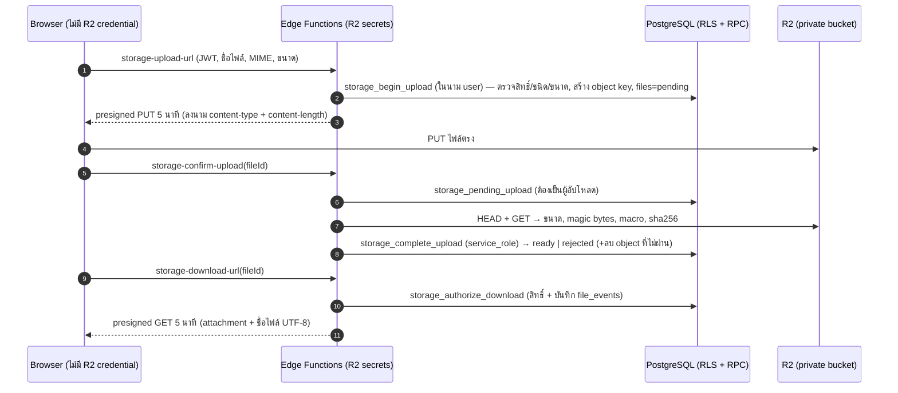

# Secure Document Storage (Phase 1.6)

> Metadata อยู่ใน Supabase PostgreSQL · ไฟล์จริงอยู่ใน Cloudflare R2 bucket **private** `sakngam-academic-documents`
> ยังไม่เชื่อม R2 จริงและยังไม่ apply ขึ้น Cloud — ทดสอบบน local ด้วย S3 emulator ที่ตรวจลายเซ็น SigV4

## 1. ภาพรวม



| ชั้น | ไฟล์ | หน้าที่ |
|---|---|---|
| Storage Adapter (server) | `supabase/functions/_shared/storage/provider.ts` | interface `StorageProvider` (presignPut / presignGet / head / getBytes / delete) |
| R2 Provider | `_shared/storage/s3.ts` + `index.ts` | S3-compatible SigV4 (Web Crypto, ไม่มี dependency) — `STORAGE_PROVIDER=r2` |
| กติกาไฟล์ | `_shared/file-rules.ts` + `private.mime_for_ext` | whitelist PDF/DOC/DOCX/XLS/XLSX, ≤ 20 MB, magic bytes, ไม่รับ macro |
| Storage Adapter (client) | `src/lib/storage/index.ts` | `DocumentStorage` — หน้าจอเรียกผ่าน interface นี้เท่านั้น |
| Metadata | migration `20261116000100_document_storage.sql` | `documents`, `files` (เวอร์ชัน), `file_events` (append-only) |

## 2. Edge Functions

| Function | ผู้เรียก | ตรวจ |
|---|---|---|
| `storage-upload-url` | ครูเจ้าของเอกสาร | JWT (Auth API), บทบาท teacher + ผูกทะเบียนครูที่ปฏิบัติงาน, เจ้าของเอกสาร, นามสกุล↔MIME, ขนาด, ชื่อไฟล์, pending ≤ 5 |
| `storage-confirm-upload` | ผู้อัปโหลดเท่านั้น | ขนาดจริง = ที่แจ้ง, magic bytes = นามสกุล, macro, sha256 |
| `storage-download-url` | เจ้าของ · หัวหน้า/เจ้าหน้าที่วิชาการ · หัวหน้ากลุ่มสาระ (scope) | สถานะ ready, บันทึก `download_url_issued` |
| `storage-delete` | ผู้อัปโหลด · หัวหน้าฝ่ายวิชาการ | ห้ามลบไฟล์ที่ `locked_at` (หลักฐานตรวจรับ) |
| `storage-cleanup` | cron (`STORAGE_CRON_SECRET`) / service_role | pending ที่เกินเวลา → expired + ลบ object ค้าง |

Object key = `schools/<school>/documents/<document>/<file_id>.<ext>` สร้างโดยฐานข้อมูล — client ไม่เห็นและกำหนดเองไม่ได้

## 3. ตั้งค่า Cloudflare R2 (เมื่อได้รับอนุมัติ — ยังไม่ทำ)

1. สร้าง bucket `sakngam-academic-documents` — **ไม่เปิด Public access / r2.dev / custom domain**
2. สร้าง R2 API Token: สิทธิ์ *Object Read & Write* **เฉพาะ bucket นี้** (ไม่ใช้ Admin token)
3. CORS ของ bucket: AllowedOrigins = โดเมน frontend ของ staging, Methods = `PUT, GET`, Headers = `content-type`, MaxAge 300
4. ตั้ง secrets ของ Edge Functions (ไม่ใส่ใน `.env` ของ frontend / Vercel):
   `supabase secrets set STORAGE_PROVIDER=r2 R2_ACCOUNT_ID=… R2_ACCESS_KEY_ID=… R2_SECRET_ACCESS_KEY=… R2_BUCKET=sakngam-academic-documents STORAGE_CRON_SECRET=… ALLOWED_ORIGINS=https://<staging-domain>`
5. ตั้งเวลาเรียก `storage-cleanup` ทุก 15 นาที (pg_cron + pg_net หรือ scheduler ภายนอก) ด้วย `Authorization: Bearer <STORAGE_CRON_SECRET>`
6. (แนะนำ) Lifecycle rule ลบ multipart upload ค้างเกิน 1 วัน

## 4. Local

```bash
npm run storage:dev
```

- `s3rver` เก็บไฟล์แทน R2 · **s3rver ไม่ตรวจลายเซ็น SigV4** จึงมี proxy (`scripts/s3-private-proxy.mjs`) ตรวจลายเซ็น/expiry/private bucket ด้วย `scripts/sigv4-verify.mjs` ซึ่งผ่าน test vector ทางการของ AWS (`npm run test:sigv4`)
- Edge Functions รันด้วย Deno (`supabase/functions/_dev/serve.ts`) เพราะ image ของ Supabase Edge Runtime ดาวน์โหลดไม่ได้ในสภาพแวดล้อมนี้ — โค้ด handler ชุดเดียวกับที่ deploy
- ข้อจำกัด: การตรวจของ R2 จริง (CORS, response-content-disposition, ลายเซ็น) ต้องยืนยันอีกครั้งบน staging
